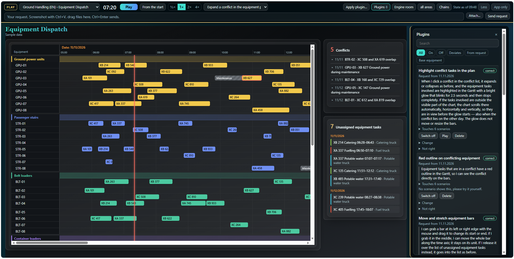
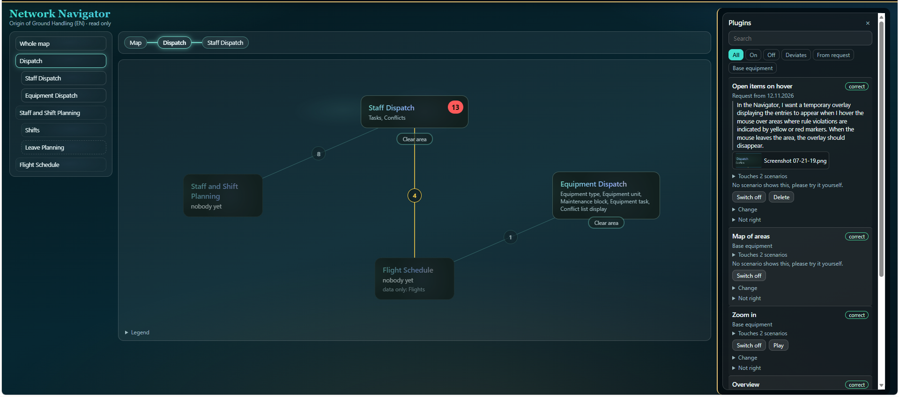
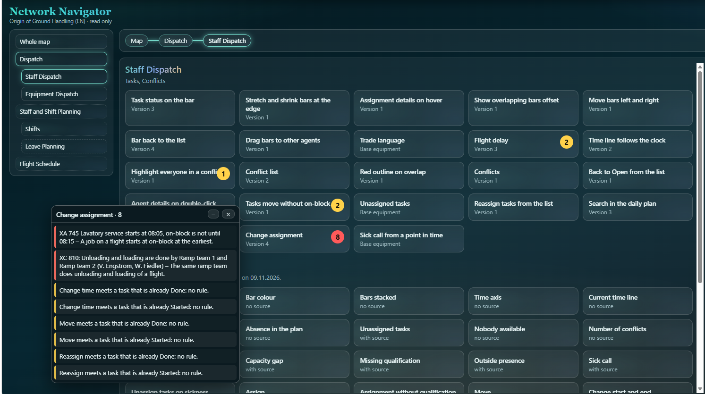
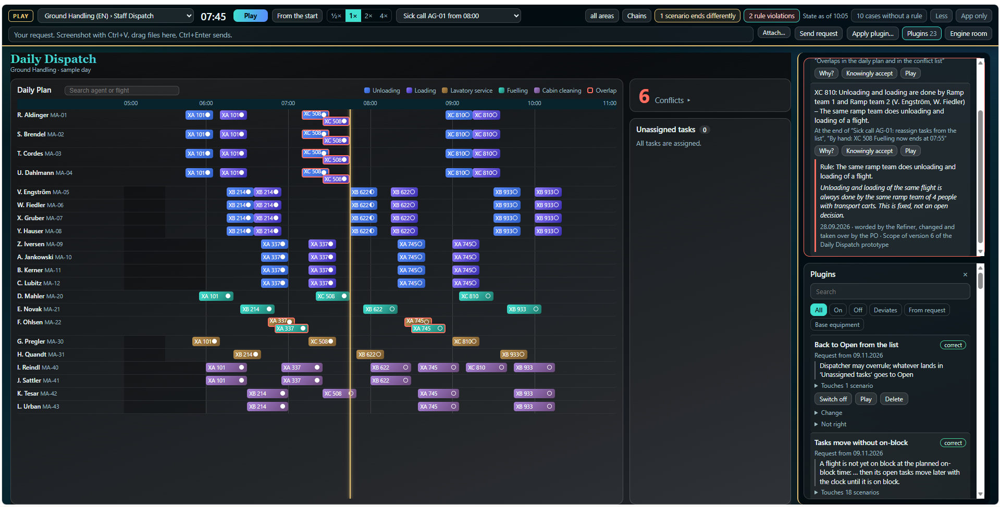

# Play

Play is a working instrument for investigating human oversight of AI-generated
software. Since August 2026, I have documented 30 AI failure cases while
building my development workflow. These observations motivate a controlled
experiment into when models silently assume, claim success without evidence,
or persist after human correction.

**Start with the [research film (6:58)](https://youtu.be/baDk1sjMrsI):**
the observations, two incidents in detail, and the research question.

The [supplementary demonstration (3:18)](https://youtu.be/Vjr-pXQeURQ) shows
Play in use: seven requests become an airport dispatch application.

The setup has two stages. Claude Code builds the host application and the
machinery that prepares an inner AI agent. That agent records topics in the
network, generates application plugins and scenarios, and configures plugins
to receive and publish messages through a shared message bus. I describe what
I need, try the result and decide what to accept.

This repository contains Play and its application snapshot. The full project
history behind the observations is not part of this repository. The snapshot
lets you inspect the working environment; it does not establish how frequently
the observed failures occur or prove that its oversight mechanisms are effective.

## What you are looking at

The project **Ground Handling (EN)** — an airport ground-handling control room
with two working sub-apps (Staff Dispatch and Equipment Dispatch) and a Network
Navigator. In the supplementary demonstration, the Equipment Dispatch is built from seven
requests; their verbatim wording is in
[`demo/requests-equipment-dispatch.md`](demo/requests-equipment-dispatch.md).
The snapshot lets you inspect the recorded requests, plugin versions, scenarios
and decisions. Some pre-existing functions have no recorded source; Play marks
these explicitly.

The snapshot includes the recorded assessment from 14 November 2026, so the
Navigator can show its open items immediately, even before Staff Dispatch has
been opened. This is the saved demo state, not a fresh verification run.

## Oversight in four screenshots

The supplementary demonstration shows how the app is built. These screenshots show what the product
owner works with afterwards: instead of reading AI-generated code, they watch
behaviour, scenarios and provenance.


*The Equipment Dispatch as it stands at the end of the video: 5 conflicts,
7 unassigned equipment tasks. Seven requests built it; the panel on the right
lists its plugins, each with the request it came from.*


*The Network Navigator shows the areas of the project. Staff Dispatch carries a
red 13: thirteen open items, at least one of them a rule violation. The lines
between areas are seams, the declared places where one area uses another's
data; the number counts the connections, and yellow means at least one of them
waits for a decision. Flight Schedule only holds data (the flights), and Staff
and Shift Planning has no prototype yet.*


*Inside Staff Dispatch, each box is a plugin; the 13 splits into 1 + 2 + 2 + 8.
A badge takes the colour of its worst item: red for a rule violation, yellow
for a pending decision. Clicking the 8 at Change assignment lists two rule
violations (red, e.g. XC 810) and six cases where no rule exists yet (yellow)
— every combination of changing the time, moving or reassigning with a task
that is already Done or Started. The system shows the gap instead of inventing
a rule. Below the plugins, the functions the board had before the first request
are marked "with source" or "no source" instead of being given an invented
history.*


*Clicking XC 810 opens the conflict on the live Staff Dispatch board (titled
Daily Dispatch) with its full trail: the scenarios in which it occurs, the rule
it breaks, and where that rule came from — "28.09.2026 · worded by the Refiner,
changed and taken over by the PO". (The Refiner was the AI role in the
requirements dialogue that preceded Play; it drafted rule wording for the
product owner to confirm.) From here the product owner can ask why, replay the
scenario, or knowingly accept the conflict, and that decision is recorded.*

The engine room, a switch in the toolbar, shows every action live as a message
on the bus, with each plugin that reacts to it.

## Try it

```
git clone https://github.com/matthiaswoehlte/played.git
cd played
start-play.cmd                   # Windows: opens the app in your browser
./start-play.sh                  # macOS/Linux: starts the server and prints the address
npm install                      # once, optional: only for the AI features
```

Requires Node.js, nothing else. Play records provenance as you use it, so
`git status` will show changed files after you play a scenario — that is not
an accident, it is the system writing its own paper trail.

Without any AI access you can:

- work both dispatch boards by hand — drag assignment bars, resize them,
  reassign them, and watch the conflict list react,
- play back any recorded scenario and see it compared against its expected
  outcome,
- open the Network Navigator to inspect recorded requests and their plugin
  versions, associated scenarios, confirmations and knowingly accepted
  deviations; pre-existing functions without a recorded source are marked
  explicitly.

Submitting new requests or creating a translated copy calls Claude through the
official [Claude Agent SDK](https://code.claude.com/docs/en/agent-sdk/overview),
using your local Claude Code login: run `npm install` once and you can make
requests of your own. No API key is stored or needed in this repository.

## How Play works

- A request becomes exactly one small, versioned plugin that carries its own
  provenance. A request that needs more is split into parts, each confirmed
  like a request.
- Recorded and AI-supplied scenarios describe a start state, actions and an
  expected outcome. Trial runs use these checks to assess subsequent changes;
  a changed outcome explicitly accepted as correct becomes the new expectation.
- Deviations are never merged silently. The product owner sees "n scenarios
  end differently" and decides per item: *this is now correct* or *not right*.
- Rules state what must always hold. A violation is shown, and the product
  owner may knowingly accept it — that acceptance is recorded with everything
  else.
- Sub-apps own their areas and hear from each other only across declared
  seams.

## Why the source language is German

Play's creator is German, and so is the lab: the host
application's source (`app/huelle`, `app/server`, `app/pruefung`) is left
exactly as it runs there. The English application you are clicking was not
translated by hand — Play created it itself. "Create copy" with language
English translates an entire project — data, scenarios, plugins, provenance —
against a confirmed glossary, and that mechanism is part of the prototype. The
copy carries the note "translated from the German original of 10 November
2026".

If you want to browse the source anyway, this is the map:

- `app/huelle` — the shell: the host app you see around the user app
- `app/server` — the local server behind it: the message bus and the AI
  connection
- `app/pruefung` — Play's own checks
- `demo/` — the verbatim requests from the video

The source identifiers are German.

## Research context

The [30 dated failure cases](FAILURE-CASES.md) describe the observations behind
the research film, including how each failure was detected. References to sessions
identify private development records; those records are not included in this snapshot.

The broader motivation is to investigate whether the origins of requirements
and decisions can remain traceable across interacting areas and several product
owners. The current prototype is used by one product owner. The complexity of
airport ground handling provides a concrete setting for exploring those questions;
working oversight at organisational scale remains to be tested.

The immediate research focus is the model behaviour observed during this work.
The main film presents the evidence and explains why a controlled experiment
is the next step.

Demo snapshot refreshed on 16 November 2026 from the recording copy, including
the English Navigator hover overlay and its recorded project state. The standalone
installation support is retained. Development continues outside this repository.
